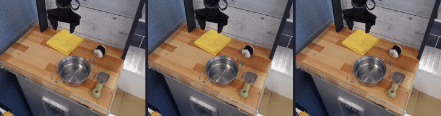

# ReCAP: Receding Context with Anchor Preservation

**Training-free context scheduling for long-horizon robot video world models.**

[Project page](https://alexander-wu.github.io/recap-project-page/) · [Experiments](docs/EXPERIMENTS.md) · [Data](docs/DATA.md) · [Weights](https://huggingface.co/easylearning/recap-robot-models) · [Validation](docs/VALIDATION.md)

ReCAP keeps the static visual context, the first dynamic visual–action block, and the most recent **W** complete blocks. It runs on a frozen autoregressive world model, using generated tokens directly. With W=6, the reference model's prompt stays within **1,931 tokens** throughout the rollout.

This repository releases the robot reference implementation for **RT-1, CALVIN, LIBERO and BridgeData V2**, derived from iVideoGPT / RLVR-World. It includes inference, evaluation, training snapshots, checksummed checkpoint manifests and the original experiment results. See [coverage](docs/COVERAGE.md) for the exact model and experiment scope.



*Selected qualitative example; see [case provenance](docs/CASES.md). Open `gallery.html` locally for all 12 examples.*

## Installation

Clone the repository and install into a new Python 3.10+ environment:

```bash
git clone https://github.com/Alexander-wu/ReCAP.git
cd ReCAP
python -m venv .venv
source .venv/bin/activate
python -m pip install -e .
recap doctor
```

The scheduler and CPU command-line utilities have no third-party dependencies. For inference, install a CUDA-compatible PyTorch build and the appropriate extras in this isolated environment:

```bash
python -m pip install -e '.[inference,metrics,assets]'
# RT-1 / CALVIN / LIBERO reference comparison uses vLLM:
python -m pip install -e '.[vllm]'
```

Bridge uses the Hugging Face backend. The [environment guide](docs/ENVIRONMENT.md) records tested versions and the distinction between the two backends. GPU inference from a freshly installed public package has not yet been revalidated; the [validation log](docs/VALIDATION.md) distinguishes release checks from historical experiments.

## Run a paired comparison

1. Download the matched **tokenizer + world model + action ranges** from [Hugging Face](https://huggingface.co/easylearning/recap-robot-models) using `recap download --dataset calvin --root .` (install `.[assets]` first). This verifies a pinned checkpoint revision. ReCAP adds no weights of its own. See [all dataset choices](model_cards/README.md).
2. Convert an episode according to [the data contract](docs/DATA.md). H64 recipes read `episode.npz` containing at least 66 aligned image/action frames.
3. Inspect the command, then run it in a new output directory:

```bash
recap run --config configs/calvin_h64.json \
  --assets ./weights --data ./data/calvin_example --output ./runs/calvin_demo --dry-run

recap run --config configs/calvin_h64.json \
  --assets ./weights --data ./data/calvin_example --output ./runs/calvin_demo \
  --verify-manifest weights_manifest.json

# Bridge: one observed frame, 32 predicted frames, first three eligible clips.
recap run --config configs/bridge_h32.json \
  --assets ./weights --data ./data/bridge_v2 --output ./runs/bridge_demo \
  --verify-manifest weights_manifest.json
```

Each config fixes the observation protocol, horizon, sampling settings and model paths. The launcher refuses to overwrite an output directory and verifies the selected checkpoint pair. Reference scripts save predictions, metrics and media; `release_launch.json` records the resolved invocation.

## Use the scheduler

```python
from recap import ReCAPContext

scheduler = ReCAPContext(context_ids, anchor_ids, window=6)
# context_ids: 1280 static tokens; anchor_ids: 80 visual + 13 action tokens
for action_ids in future_actions:
    visual_ids = sample_frame(model, scheduler.prompt())  # your 80-token sampler
    evicted = scheduler.append(visual_ids, action_ids)
    # When evicted, rebuild the model cache with rebased positions before sampling.
```

The scheduler retains tokens only; it does not manage the model's KV cache. The provided reference backends implement prompt rebuilding. A regression test compares every scheduler prompt against the preserved reference over a 64-frame horizon.

## Contents

| Path | Purpose |
|---|---|
| `src/recap/` | Scheduling API, CLI, input validation and verified asset downloads |
| `src/recap/reference/` | Paired inference, RQ2–RQ4 metrics, attention and throughput benchmarks |
| `configs/` | RT-1/CALVIN/LIBERO H64 and Bridge H32 recipes |
| `training/` | Original trainers, converters, fine-tuning adapters and historical recipes |
| `artifacts/results/` | Archived quantitative results and selection records |
| `artifacts/cases/` | Selected GIFs and provenance; raw datasets are external |
| `weights_manifest.json`, `model_cards/` | Exact checkpoint identities, dataset pairing and hosting status |

## Evaluation protocol

- Predict future images from observed images and supplied ground-truth actions. These are visual open-loop experiments; no closed-loop robot success rate is measured.
- RT-1/CALVIN/LIBERO use two observed frames. Bridge duplicates its single observation as the initial dynamic anchor.
- Never decode and re-encode generated pixels or use true future images as rollout context. Tokenizer reconstruction is a separately labeled codec reference.
- Compare methods with the same checkpoint, inputs, seed, precision and sampling parameters. Historical run metadata controls reproduction of each archived table.
- Selected showcase GIFs illustrate behavior. Report aggregate metrics with their actual case counts and sampling protocol.

## Development

```bash
python -m pip install -e '.[dev]'
python -m unittest discover -s tests -v
python scripts/audit_release.py
python -m build
```

## License and citation

New ReCAP code is **Apache-2.0**. Vendored upstream components retain MIT, BSD and Apache notices; see [LICENSE](LICENSE), [NOTICE](NOTICE) and [third-party attribution](THIRD_PARTY_NOTICES.md). Dataset and model terms remain separate.

Paper: *Efficient Training-Free Context Scheduling for Long-Horizon Robot Video World Models*. An archival paper citation will be added when its public identifier and author metadata are available. For this code release, see [CITATION.cff](CITATION.cff).
